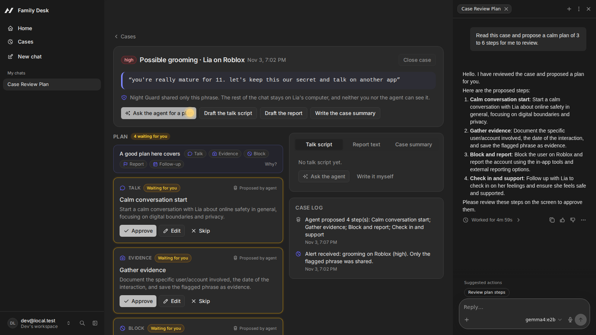
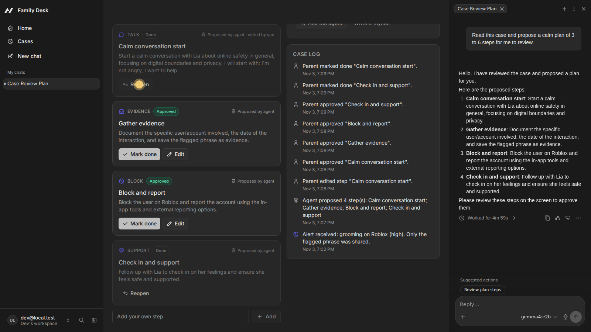
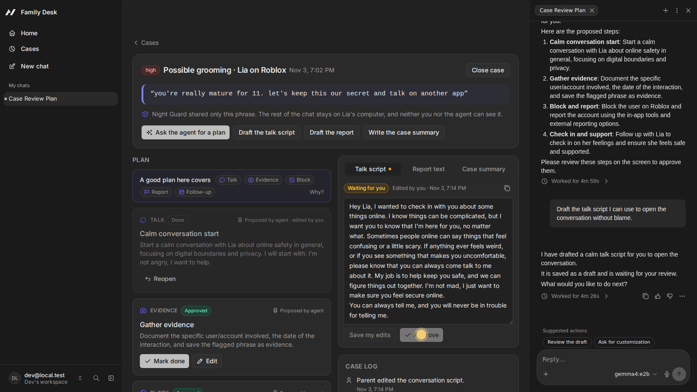
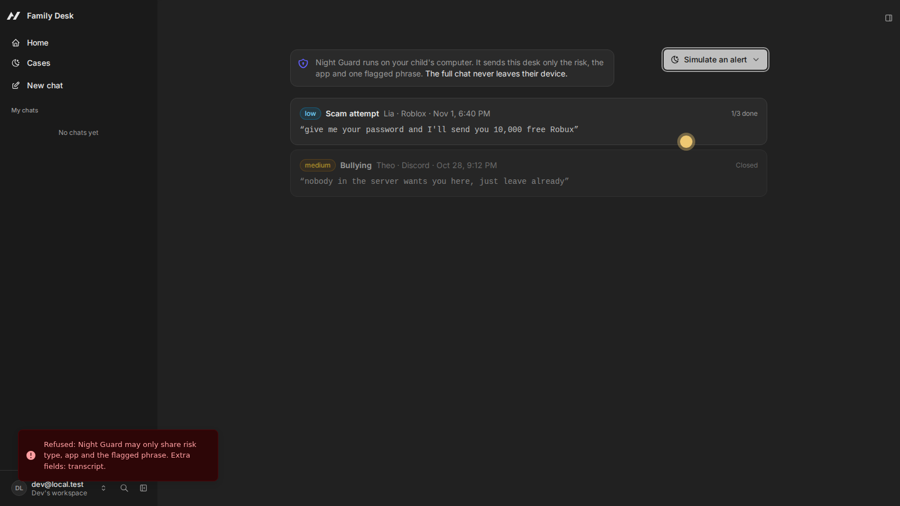
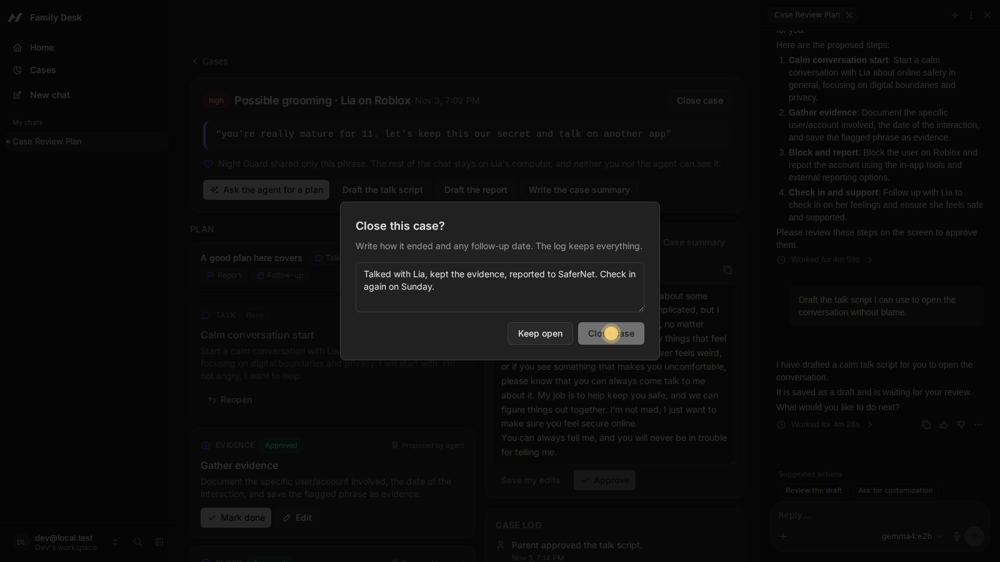

# Night Guard Family Desk

A desk where a parent and an AI agent work the same case after a child-safety alert.

[Night Guard](https://github.com/jenniferevangelista-de/night-guard) runs on the child's computer and flags risky chats (grooming, bullying, scams, self-harm, explicit content). By design it shares only three things with the family: the risk type, the app and the one flagged phrase. The full conversation never leaves the child's device.

That leaves parents with a hard question at a bad moment: *now what?* Family Desk answers it. When an alert arrives, a case opens. The agent proposes a plan (how to talk without blame, what evidence to keep, when to block, where to report). The parent reviews, edits and approves each step. The agent drafts the conversation script, the report text and the case summary; the parent edits and approves those too. Every action by either side lands in one case log.

Built with [Agent-Native](https://www.agent-native.com) for the Builder.io Agent-Native Hackathon (Oct 27 to Nov 9, 2026). All data in this repo and in the demo is fictional.



| | |
|-|-|
|  |  |
|  |  |

## How people and the agent share the work

| | Parent (UI) | Agent (chat) |
|-|-|-|
| Open a case from a Night Guard alert | yes | yes |
| Propose or edit plan steps | yes | yes |
| Approve, skip, mark done, reopen a step | **yes** | no (`uiOnly` action) |
| Write talk script, report text, case summary | yes | yes |
| Approve a draft | **yes** | no (`uiOnly` action) |
| Close the case | yes | only after the parent approves the call (`needsApproval`) |

Both sides call the same typed actions in `actions/`, so the rules hold no matter who acts:

- **Privacy by contract.** `receive-alert` accepts only risk type, app, child alias, severity, time and one flagged phrase (one line, at most 240 characters). A payload with anything else, such as a transcript, is refused with `privacy_violation`. The database has no column that could hold a chat.
- **The agent proposes, the parent decides.** Steps and drafts start as "waiting for you". If the agent edits a step the parent already approved, it goes back to waiting.
- **No loose ends.** A case cannot close while any step is still waiting for review.
- **One record.** Every action writes to the case log, labeled parent, agent or Night Guard.
- **Guidance from the data.** `get-case` returns, for the case's risk type, the step kinds a good plan covers and the official channels to report to. Even a small local model follows it, and the parent can see why each step is there.

The rules live in one pure module, `server/lib/case-rules.ts`, which the actions call and the unit tests cover.

The agent follows a playbook skill (`.agents/skills/family-safety-playbook/SKILL.md`): calm talk without punishment, keep evidence before blocking, never contact the other person, report grooming to SaferNet Brasil or the NCMEC CyberTipline, call the police in immediate danger, and suggest professional support (CVV 188 in Brazil, 988 in the US) for self-harm signals. It is guidance for parents, not legal or clinical advice.

## Model and cost

The agent runs on **Gemma 4 E2B through Ollama**, on CPU, inside the dev environment. No paid API, no key. This matches Night Guard, which also runs Gemma locally. On 4 CPU cores a plan takes a few minutes; the prompt is kept lean (`leanPrompt`, `frameworkTools: "minimal"`) and a tiny proxy turns off the model's thinking mode, which made it about 5 times faster. Any provider Agent-Native supports can be used instead by changing `AGENT_ENGINE` and `AGENT_MODEL`.

## Run it

Requires Node 22.22+, pnpm and [Ollama](https://ollama.com).

```bash
ollama pull gemma4:e2b
OLLAMA_CONTEXT_LENGTH=16384 ollama serve   # the agent prompt needs more than the 2k default
python3 scripts/ollama-no-think.py &       # turns off Gemma's thinking mode, about 5x faster on CPU

pnpm install
cat > .env <<EOF
AGENT_ENGINE=ai-sdk:ollama
OLLAMA_BASE_URL=http://127.0.0.1:11435
AGENT_MODEL=gemma4:e2b
EOF
pnpm dev
```

Open `/cases`, use **Simulate an alert** to create a fictional case, then **Ask the agent for a plan**. The menu also has a test that sends a full chat, which the desk refuses.

For a shared demo machine (not production) you can add `AUTH_DISABLED=true` so every request runs as one local user.

## Checks

```bash
pnpm test                 # unit tests for the case rules (privacy, transitions, re-approval, guidance)
pnpm lint                 # oxlint + oxfmt on the app's own code
pnpm typecheck            # after one `pnpm dev`, which generates the action types
pnpm agent-native:doctor  # the framework's own guards (scoping, migrations, credentials)
```

CI (`.github/workflows/ci.yml`) runs lint, tests and doctor on every push.

## Videos

A narrated film and a real tour of the app, made by `video/make_videos.py`. How they were made, and the music credit, are in [docs/VIDEOS.md](docs/VIDEOS.md).

## Project map

- `actions/`: `receive-alert`, `list-cases`, `get-case`, `add-plan-steps`, `update-step`, `review-step` (UI only), `save-draft`, `approve-draft` (UI only), `add-case-note`, `close-case`
- `server/lib/case-rules.ts`, `tests/`: the rules as pure functions, and their tests
- `server/db/schema.ts`, `server/plugins/db.ts`: cases, steps, drafts, case log (Postgres / PGlite)
- `app/routes/cases._index.tsx`, `app/routes/cases.$caseId.tsx`: case list and case desk
- `server/plugins/agent-chat.ts`, `AGENTS.md`, `.agents/skills/family-safety-playbook/`: agent prompt, rules and playbook

## Pre-existing work vs built during the hackathon

**Pre-existing (before Oct 27, 2026):**

- **Night Guard** ([repo](https://github.com/jenniferevangelista-de/night-guard)), my child-safety detector, submitted to the DEV Hacktoberfest challenge on Oct 24, 2026. Family Desk reuses its idea and its privacy rule (the family sees the risk, never the whole chat). **No Night Guard code is copied into this repo.** The alert shape (risk type, app, flagged phrase) mirrors what Night Guard shares.
- **Agent-Native Chat template** (`@agent-native/core` 0.223, MIT): the scaffold from `npx @agent-native/core create --template chat`, which provides the app shell, sign-in, agent chat sidebar, action runtime, sharing helpers, i18n files, framework skills under `.agents/skills/` (except the playbook) and UI components.
- **Libraries:** React, React Router, Drizzle ORM, Zod, Tailwind, Tabler Icons, shadcn-style components via `@agent-native/toolkit`, Ollama and the Gemma 4 E2B open model.

**Built during the hackathon (Nov 3 to Nov 9, 2026):**

- The case data model and migration (cases, steps, drafts, case log, sharing table).
- All domain actions listed above, including the privacy contract in `receive-alert`, UI-only approvals, the re-approval rule for agent edits and the `needsApproval` gate on `close-case`.
- The case list and case desk screens (alert card, plan review, draft editor with approval, case log, close dialog).
- The agent's system prompt, the `AGENTS.md` section and the family-safety playbook skill.
- Sidebar link, navigation state (`caseId`) and home route changes in the template.
- Local free-model setup (Gemma 4 E2B on Ollama, the no-thinking proxy, the lean prompt) and the risk guidance in `get-case`.
- Unit tests, lint setup, CI, the video script and these docs.

## License

MIT. Agent-Native template files keep their original license.
